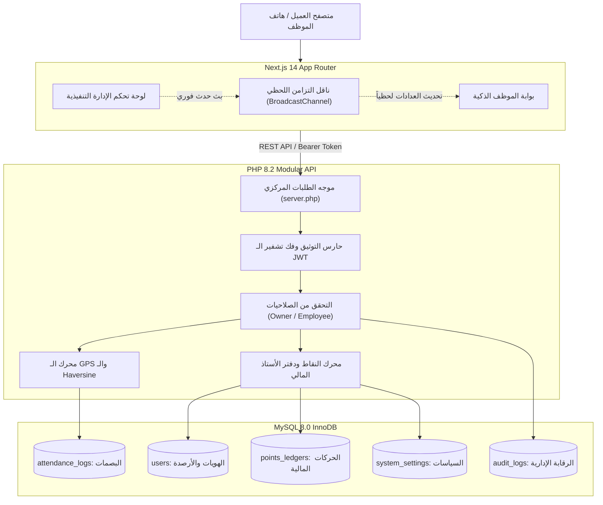

# Attend Pro | Enterprise Smart Attendance & Automated Payroll System
### نظام إدارة الحضور الذكي والرواتب والانضباط الميداني بالـ GPS

[](https://nextjs.org/)
[](https://www.php.net/)
[](https://www.mysql.com/)
[](https://tailwindcss.com/)
[](https://jwt.io/)
[](LICENSE)

---

## نظرة عامة على المشروع (Project Overview)

**Attend Pro** هو نظام مؤسسي متكامل من فئة B2B SaaS مصمم خصيصاً للشركات والمؤسسات لإدارة ومتابعة حضور الموظفين الميداني بدقة متناهية عبر الـ GPS، وربط الانضباط اليومي بنظام مروري ذكي للنقاط (أخضر، أحمر، أسود) ومحفظة مالية لحظية متوافقة مع حسابات InstaPay والتحويلات البنكية المباشرة.

يتميز النظام بهوية بصرية أحادية فاخرة (**Strict Monochrome / Shadcn UI / Vercel Style**) داعمة للغة العربية بالكامل (**RTL**) وخالية تماماً من الرموز التعبيرية لضمان الطابع المؤسسي الجاد.

---

## المميزات الهندسية الأساسية (Key Architectural Features)

1. **التحقق الجغرافي الذكي ومكافحة التلاعب (GPS Geofencing & Anti-Spoofing):**
   - احتساب المسافة الفاصلة بين الموظف ومقر العمل على السيرفر بدقة متناهية باستخدام **معادلة Haversine الرياضية**.
   - فلترة دقة إشارة الـ GPS ورفض الإشارات الضعيفة أو الوهمية (أكبر من 50 متراً) لحظر تطبيقات Fake GPS.
   - دعم كامل لتعدد الفروع والنطاقات الجغرافية المخصصة لكل فرع (Multi-Branch Support).

2. **التوقيت الإجباري للسيرفر (Server-Time Authority):**
   - حظر تام للاعتماد على توقيت جهاز الموظف؛ يتم التحقق واحتساب النوافذ الزمنية اعتماداً على ساعة الخادم المزامنة عبر بروتوكول NTP.
   - نوافذ حضور منضبطة:
     - **07:00 ص - 08:59 ص:** حضور مبكر سوبر (+1 نقطة خضراء و +1 كريديت تعويضي).
     - **09:00 ص - 09:15 ص:** فترة السماح الرسمية (+1 نقطة خضراء).
     - **09:16 ص - 11:59 ص:** فترة التأخير (استهلاك تلقائي لدرع الحماية أو تسجيل نقطة حمراء وخصم فوري).
     - **12:00 م (Cutoff Gate):** إغلاق البوابة اليومية وتسجيل غياب ونقطة سوداء وخصم يوم كامل.

3. **حوكمة الصلاحيات الصارمة (Strict Executive RBAC):**
   - **صلاحيات حصرية للمدير (Owner Only):** المدير التنفيذي هو الجهة الوحيدة المخولة بتطبيق الخصومات اليدوية، منح المكافآت، تعديل سياسات البونص، مراجعة التظلمات والإجازات، وتصدير التقارير المالية.
   - **تأمين الموظف:** منع الصرف الذاتي أو تعديل النقاط ذاتياً لضمان النزاهة والانضباط المالي المؤسسي.

4. **محرك النقاط ودرع الحماية التعويضي (Points & Ledger Engine):**
   - **درع الحماية (Early Green Credits):** رصيد مكتسب من الحضور المبكر يحمي راتب الموظف تلقائياً ويمتص خصم التأخير الأول.
   - **إلغاء النقاط الحمراء:** إمكانية استبدال 5 نقاط خضراء لمحو نقطة حمراء واحدة.
   - **سلسلة الـ 5 أيام المتتالية:** محو النقطة السوداء واسترداد الخصم عند الالتزام بالحضور المبكر لمدة 5 أيام عمل متتالية.

5. **التزامن اللحظي عبر النوافذ (Cross-Tab Real-Time Sync):**
   - تحديث واجهات الموظف والمدير فورياً دون إعادة تحميل الصفحة عبر `BroadcastChannel API` عند اتخاذ أي إجراء إداري أو تسجيل بصمة جديدة.

6. **مركز التقارير والمحفظة المالية (InstaPay & Payroll Export Center):**
   - تصدير كشوف الرواتب المعتمدة بصيغة **Excel (CSV)** مهيأة للتحويل الفوري عبر شبكة InstaPay للشركات.
   - استخراج تقارير تدقيق مالي رسمية مطبوعة بصيغة **PDF**.

---

## البنية التقنية (Tech Stack)

| الطبقة | التقنيات المستخدمة | الوصف الفني |
| :--- | :--- | :--- |
| **الواجهة الأمامية (Frontend)** | Next.js 14 (App Router), React 18, Tailwind CSS, Lucide Icons, Axios | واجهة تفاعلية أحادية سريعة الاستجابة، خالية من الـ Emojis، معالجة فورية للبيانات ودعم كامل لـ RTL. |
| **الخادم الخلفي (Backend)** | PHP 8.2+, PDO MySQL, Modular MVC Architecture | معالجة برمجية فائقة السرعة، توثيق JWT (HS256)، وتحقق رياضي من الـ Geofencing. |
| **قاعدة البيانات (Database)** | MySQL 8.0 / MariaDB (InnoDB Engine) | دعم كامل لمعاملات ACID، قفل السجلات على مستوى الصف (Row Locking)، وسلامة المراجع. |
| **البروتوكولات والأمان (Security)** | Bcrypt Hashing, JWT Tokens, Haversine Formula, CORS, UFW | حماية ضد هجمات IDOR، حقن SQL، التلاعب بالتوقيت، وتزييف الموقع الجغرافي. |

---

## الهيكل المعماري للنظام (Architecture Diagram)



---

## أدلة التوثيق التقني الشاملة (Technical Documentation)

يحتوي مجلد [`docs/`](docs/) على توثيق هندسي ومعماري تفصيلي لكافة جوانب المنظومة:

1. **[مخطط قاعدة البيانات والعلاقات (`docs/database-schema.md`)](docs/database-schema.md):** توثيق شامل لكل الجداول (`users`, `branches`, `attendance_logs`, `points_ledgers`, `dispute_tickets`, `leave_requests`, `system_settings`, `audit_logs`)، الأنواع، القيود، ومخطط الـ ERD.
2. **[قائمة تدابير الأمان ومكافحة التلاعب (`docs/security-checklist.md`)](docs/security-checklist.md):** معايير التشفير بـ Bcrypt، حماية الـ JWT، معادلة Haversine، توقيت الخادم الإجباري، والتحقق من صلاحيات الـ RBAC.
3. **[مرجع واجهات برمجة التطبيقات (`docs/api-documentation.md`)](docs/api-documentation.md):** توثيق كامل لجميع مسارات الـ REST API، الترويسات، معايير الاستجابة، ونماذج الـ Request/Response.
4. **[دليل النشر والاستضافة السحابية (`docs/deployment-guide.md`)](docs/deployment-guide.md):** خطوات استضافة النظام على Vercel و Render و Ubuntu VPS مع ضبط Nginx وشهادات SSL المجانية.
5. **[نظرة عامة على المعمارية والهيكلية (`docs/architecture-overview.md`)](docs/architecture-overview.md):** الفلسفة المعمارية، محرك النقاط، التزامن اللحظي، ومخططات التسلسل التفاعلية (Sequence Diagrams).

---

## متطلبات التشغيل والبدء السريع (Quick Start Guide)

### المتطلبات الأساسية (Prerequisites):
- **Node.js:** v18.0 أو أحدث.
- **PHP:** v8.1 أو أحدث (مع ملحقات `pdo_mysql`, `curl`, `mbstring`, `openssl`).
- **MySQL:** v8.0 أو MariaDB مكافئ.
- **Git**

### 1. استنساخ المستودع (Clone Repository):
```bash
git clone https://github.com/ziadmohamedmarz0uk/attend.git
cd attend
```

### 2. إعداد قاعدة البيانات والخادم الخلفي (Backend):
```bash
# إنشاء قاعدة البيانات في MySQL
mysql -u root -p -e "CREATE DATABASE smart_attendance_db CHARACTER SET utf8mb4 COLLATE utf8mb4_unicode_ci;"

# نسخ ملف البيئة وضبط المتغيرات
cp backend/.env.example backend/.env

# تشغيل خادم الـ PHP
php -S 127.0.0.1:8000 backend/server.php
```

### 3. إعداد وتشغيل الواجهة الأمامية (Frontend):
```bash
cd frontend

# تثبيت الاعتماديات
npm install

# نسخ ملف البيئة للواجهة
cp .env.example .env.local

# تشغيل خادم التطوير
npm run dev
```

افتح المتصفح على الرابط: `http://localhost:3000`

---

## الحسابات وبيانات الدخول التجريبية (Default Test Credentials)

| الدور الوظيفي | البريد الإلكتروني | كلمة المرور | الصلاحيات المتاحة |
| :--- | :--- | :--- | :--- |
| **المدير التنفيذي (Owner)** | `owner@company.com` | `password123` | تحكم كامل: تطبيق الخصومات، صرف المكافآت، اعتماد الإجازات، حل التظلمات، وتصدير كشوف الرواتب. |
| **الموظف الميداني (Employee)** | `ahmed@company.com` | `password123` | تسجيل الحضور بالـ GPS، متابعة الرصيد و InstaPay، تقديم الإجازات والتظلمات، واستبدال النقاط. |

---

## هيكل المجلدات (Project Directory Structure)

```text
attend/
├── backend/                  # الخادم الخلفي ومحرك العمليات (PHP Engine)
│   ├── app/                  # الموديولات البرمجية (Attendance, Auth, Points, Leaves, OwnerControl)
│   ├── config/               # إعدادات التطبيق ونطاقات الـ Geofencing
│   ├── database/             # ملفات التهيئة والميجريشن
│   ├── server.php            # موجه الـ API الرئيسي وخادم المعالجة
│   └── .env.example          # قالب متغيرات البيئة السرية للخادم
├── docs/                     # التوثيق التقني والهندسي الشامل للمشروع
│   ├── api-documentation.md
│   ├── architecture-overview.md
│   ├── database-schema.md
│   ├── deployment-guide.md
│   └── security-checklist.md
├── frontend/                 # الواجهة الأمامية (Next.js 14 App Router)
│   ├── src/
│   │   ├── app/              # صفحات التطبيق (Login, Employee Dashboard, Owner Dashboard)
│   │   ├── components/       # المكونات التفاعلية المنفصلة (GeofenceCard, Wallet, Tables, Modals)
│   │   ├── context/          # سياق المصادقة وإدارة الجلسات (AuthContext)
│   │   ├── lib/              # عميل Axios ومحرك التزامن اللحظي (syncEvents)
│   │   └── services/         # طبقة استدعاء الـ APIs
│   ├── tailwind.config.js    # ضبط سمة الـ Monochrome والخطوط
│   └── package.json
├── SYSTEM_MASTER_GUIDE.md    # الدليل المركزي الإرشادي
├── .gitignore                # قواعد استبعاد الملفات الحساسة والحزم
└── README.md                 # وثيقة التعريف الرئيسية بالمشروع
```

---

## الترخيص والمطور (License & Author)

- **المطور الرئيسي:** [زياد محمد مرزوق (Ziad Mohamed Marzouk)](https://github.com/ziadmohamedmarz0uk)
- **الترخيص البرمجي:** مرخص تحت رخصة [MIT License](LICENSE) المفتوحة للاستخدام التجاري والمؤسسي.
