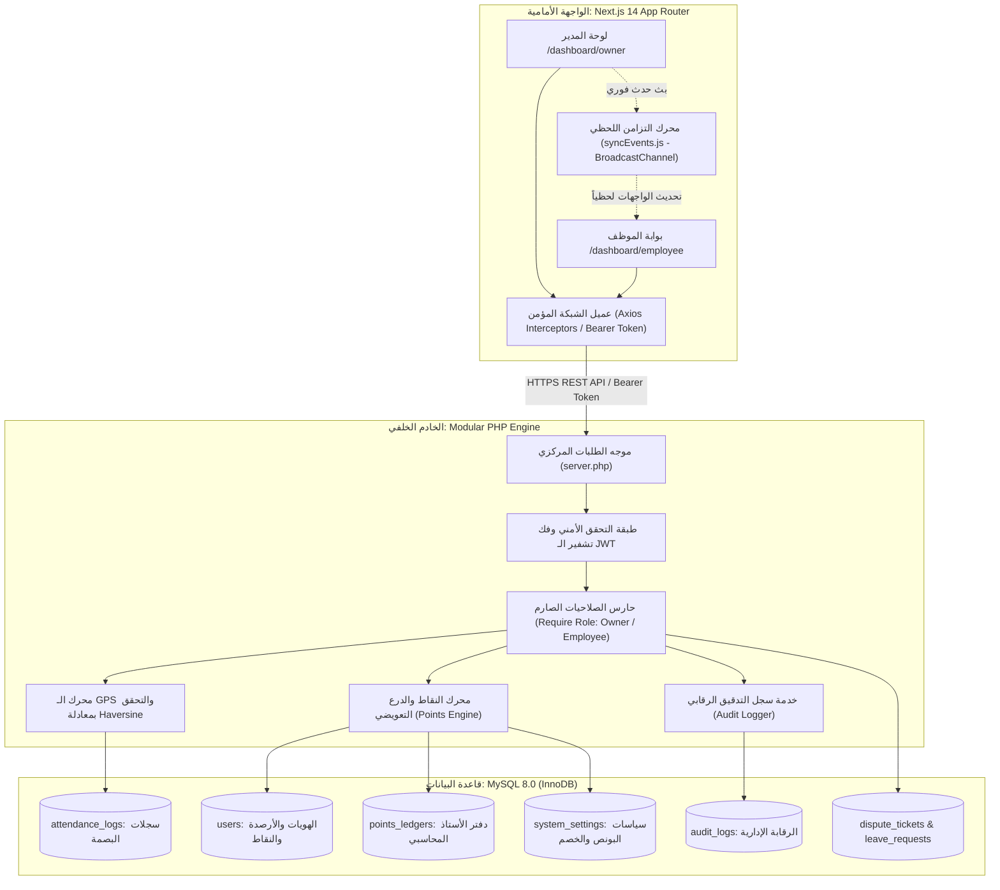
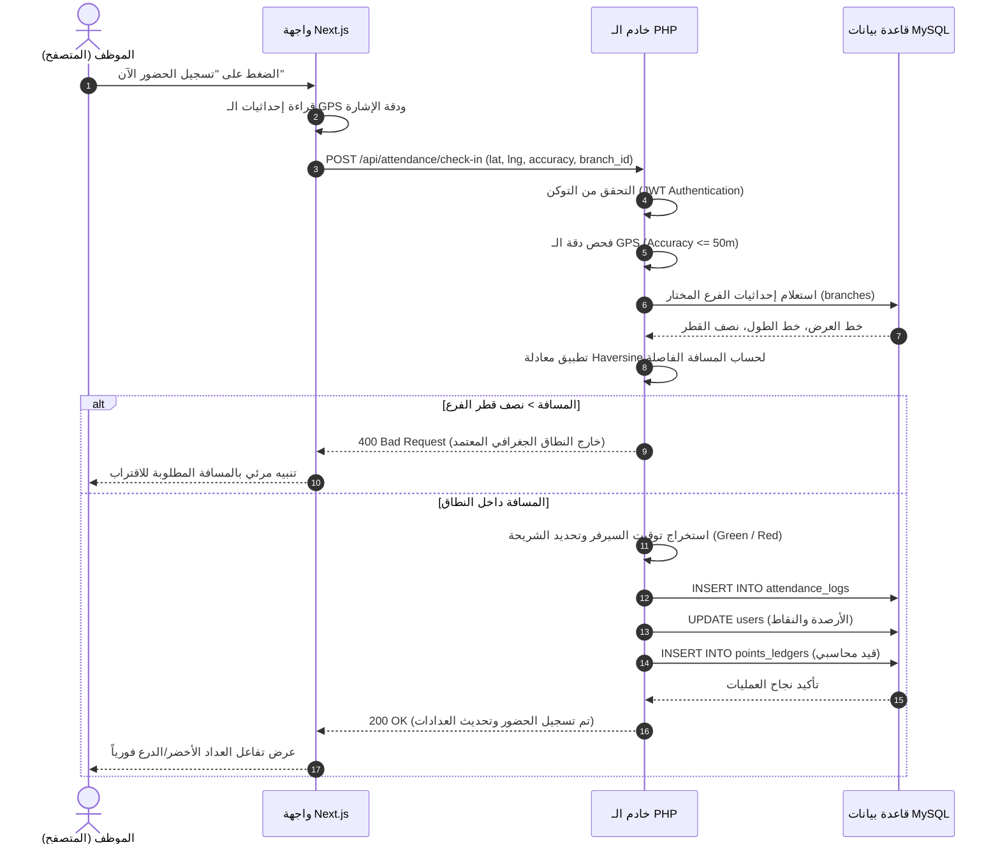
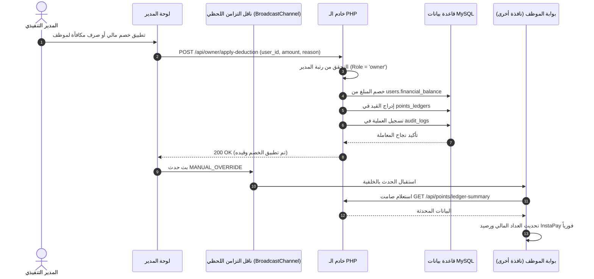

# نظرة عامة على المعمارية وهيكلية النظام
## System Architecture Overview, Engineering Design and State Synchronization

---

## 1. الفلسفة المعمارية للنظام (Architectural Vision)

نظام **Attend** هو منصة B2B SaaS متقدمة لإدارة الحضور الميداني بالـ GPS والتحكم بالرواتب والحوافز المالية اللحظية. تم تصميم النظام وفق مبادئ المعمارية الحديثة:
- **الفصل التام للمهام (Clean Decoupled Architecture):** فصل طبقة العرض والواجهات (Next.js 14) عن طبقة المنطق والأعمال وقواعد البيانات (PHP/MySQL) عبر واجهات برمجة تطبيقات آمنة (RESTful APIs).
- **التصميم الأحادي الفاخر (Strict Monochrome Design System):** الاعتماد على فلسفة بصرية مستوحاة من Shadcn UI و Vercel، مقتصرة على درجات الأسود والأبيض والرمادي مع مؤشرات لونية دقيقة ومدروسة للمرور، مع الدعم الأصيل للغة العربية باتجاه القراءة من اليمين إلى اليسار (RTL) وخلو تام من الرموز التعبيرية (Zero Emojis).
- **المصدر الأوحد للحقيقة (Single Source of Truth):** خادم الـ Backend وقاعدة بيانات MySQL هما المرجع الحصري للتوقيت، الأرصدة، واحتساب المسافات الجغرافية.
- **التزامن اللحظي عبر النوافذ (Cross-Tab Synchronization):** ربط تبويبات المتصفح المختلفة للعميل عبر بروتوكول `BroadcastChannel` لتحديث الواجهات فور حدوث أي قرار إداري أو بصمة جديدة دون الحاجة لإعادة تحميل الصفحة.

---

## 2. المخطط المعماري الشامل (High-Level Architecture)

---

## 3. الركائز الهندسية الأساسية (Core Engineering Pillars)

### 3.1. التوقيت الإجباري للخادم (Server-Time Authority)
- لا يعتمد النظام إطلاقاً على توقيت جهاز الموظف؛ يتم سحب التوقيت مباشرة من ساعة السيرفر المزامنة مع UTC/NTP.
- يتم تقسيم ساعات اليوم إلى 5 نوافذ زمنية ثابتة:
  1. **قبل الساعة 07:00 ص:** البوابة مغلقة تلقائياً.
  2. **نافذة الحضور المبكر (07:00 ص - 08:59 ص):** احتساب +1 نقطة خضراء مع منح +1 كريديت تعويضي في `users.early_green_credits`.
  3. **فترة السماح الرسمية (09:00 ص - 09:15 ص):** احتساب +1 نقطة خضراء دون أي خصومات.
  4. **فترة التأخير (09:16 ص - 11:59 ص):** فحص رصيد الكريديت التعويضي؛ إذا كان $\ge 1$ يُستهلك كريديت واحد لحماية الراتب وتلغى النقطة الحمراء، وإذا كان $0$ تُقيد نقطة حمراء ويُخصم مبلغ التأخير المعتمد من `financial_balance`.
  5. **إغلاق البوابة اليومي (12:00 م Cutoff):** إغلاق تلقائي لا يقبل البصمات، وتقييد غياب ونقطة سوداء وخصم يوم كامل.

---

### 3.2. حوكمة الصلاحيات التنفيذية (Executive RBAC)
- **صلاحيات حصرية للمدير (Owner Monopoly):**
  - المدير هو المسؤول الوحيد عن تحديد المبالغ وتطبيق الخصومات اليدوية (`apply-deduction`).
  - صرف مكافآت الانضباط والبونص اليدوي (`grant-bonus`).
  - تعديل مبالغ السياسات المركزية في `system_settings` (`bonus-settings`).
  - مراجعة واعتماد أو رفض طلبات الإجازات والتظلمات.
  - تصدير كشوف الرواتب والتحويلات البنكية لملفات Excel و PDF.
- **حظر وتأمين حسابات الموظفين:**
  - لا يملك الموظف أي صلاحية لتعديل رصيده أو صرف مبالغ لنفسه بصورة ذاتية.
  - جميع عمليات الموظف محصورة في: تسجيل الحضور بالـ GPS، تقديم طلبات الإجازة، تقديم تظلم، استبدال 5 نقاط خضراء بنقطة حمراء، وتحديث كود InstaPay المعتمد للسحب.

---

### 3.3. محرك النقاط والدرع التعويضي (Points & Compensation Ledger Engine)
يعمل المحرك بنظام دفتر أستاذ محاسبي دقيق (Double-Entry Audit Ledger):
- **النقاط الخضراء (Green Points):** تزداد بمقدار +1 مع كل حضور منضبط أو مبكر.
- **درع الحماية التعويضي (Early Green Credits):** رصيد مكتسب من الحضور المبكر (قبل 09:00 ص) يمتص تلقائياً خصم أول تأخير للموظف ويحمي راتبه.
- **النقاط الحمراء (Red Points):** تُسجل عند التأخير دون رصيد حماية، وتؤدي لخصم قيمة التأخير فورياً من الرصيد المالي. يمكن للموظف استبدال 5 نقاط خضراء لمحو نقطة حمراء واحدة.
- **النقاط السوداء (Black Points):** تُسجل عند الغياب التام وإغلاق البوابة، وتخصم يوم عمل كامل. يتيح النظام محو نقطة سوداء تلقائياً عند تحقيق سلسلة انضباط مبكر لمدة 5 أيام متتالية (`consecutive_early_days = 5`).

---

## 4. مخططات التسلسل التفاعلية (Sequence Diagrams)

### 4.1. دورة تسجيل الحضور بالـ GPS والتحقق الجغرافي (GPS Check-In Flow)

---

### 4.2. دورة التعديل المالي للمدير وتزامن النوافذ اللحظي (Owner Manual Override & Sync)

---

## 5. استراتيجية إدارة الأخطاء والمرونة (Error Handling & Fallbacks)

- **الحماية من السقوط (Zero White Screen Policy):** في حال وجود انقطاع مؤقت في الاتصال، تقوم الواجهة الأمامية بالاعتماد على البيانات المخبأة محلياً في `localStorage` لعرض الصفحة بسلاسة مع إظهار شارة تنبيهية لحالة الاتصال.
- **منع النقرات المزدوجة (Anti-Double-Click Lock):** جميع أزرار الإجراءات في الواجهة الأمامية تُقفل فور النقر عليها وتُظهر مؤشر تحميل دوار (`Loader2`) لمنع إرسال طلبات مكررة لنفس العملية.
- **ضمانات قاعدة البيانات (Database Constraints):** استخدام قيود `UNIQUE` على البريد الإلكتروني والـ Primary Keys وفهارس البحث المركبة لمنع تكرار القيود أو تضارب البيانات المالية.

