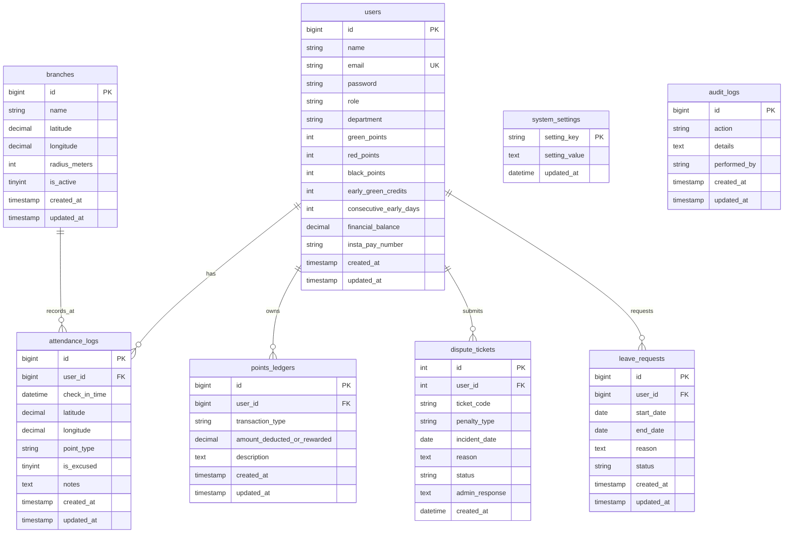

# وثيقة المخطط الهيكلي لقاعدة البيانات والعلاقات
## Enterprise MySQL Database Schema and Entity-Relationship Specification

---

## 1. نظرة عامة على البنية التحتية للبيانات

تعتمد البنية التحتية لنظام الحضور والرواتب الذكي (Attend System) على محرك **MySQL 8.0 / MariaDB** باستخدام محرك التخزين **InnoDB** الذي يضمن:
- الامتثال الكامل لمعايير المعاملات المباشرة (ACID Transactions) لضمان اتساق العمليات المالية وسجلات الخصومات والمكافآت.
- استخدام تقنية قفل السجلات على مستوى الصف (Row-Level Locking) عند تحديث الأرصدة المالية لمنع حدوث التزامن المتضارب (Race Conditions).
- دعم العلاقات المنطقية والمفاتيح الخارجية (Foreign Keys) مع سلامة المراجع (Referential Integrity).
- الترميز الشامل للبيانات باللغة العربية عبر ترميز `utf8mb4_unicode_ci`.

---

## 2. المخطط الكياني للعلاقات (Entity-Relationship Diagram)



---

## 3. تفاصيل الجداول والحقول (Data Dictionary)

### 3.1. جدول المستخدمين (`users`)
يمثل الكيان المركزي لإدارة الهوية، الصلاحيات، وحسابات النقاط التراكمية والأرصدة المالية.

| اسم الحقل | النوع البرمجي | الفهرسة / القيد | القيمة الافتراضية | الوصف الفني |
| :--- | :--- | :--- | :--- | :--- |
| `id` | `BIGINT UNSIGNED` | Primary Key, Auto Increment | تلقائي | المعرف الرقمي الفريد للمستخدم |
| `name` | `VARCHAR(255)` | NOT NULL | لا يوجد | الاسم الثلاثي أو الرباعي للموظف / المدير |
| `email` | `VARCHAR(255)` | NOT NULL, UNIQUE | لا يوجد | البريد الإلكتروني المعتمد لتسجيل الدخول والمطابقة |
| `password` | `VARCHAR(255)` | NOT NULL | لا يوجد | كلمة المرور المشفرة بخوارزمية Bcrypt الآمنة |
| `role` | `VARCHAR(50)` | NOT NULL | `'employee'` | دور المستخدم وصلاحياته في النظام (`'owner'`, `'employee'`) |
| `department` | `VARCHAR(255)` | NULL | NULL | الإدارة أو القسم التابع له الموظف |
| `green_points` | `INT UNSIGNED` | NOT NULL | `0` | رصيد النقاط الخضراء التراكمي (مؤشر الانضباط والحضور المبكر) |
| `red_points` | `INT UNSIGNED` | NOT NULL | `0` | رصيد النقاط الحمراء (مخالفات التأخير الصباحي بعد فترة السماح) |
| `black_points` | `INT UNSIGNED` | NOT NULL | `0` | رصيد النقاط السوداء (مخالفات الغياب غير المبرر وإغلاق البوابة) |
| `early_green_credits` | `INT UNSIGNED` | NOT NULL | `0` | رصيد درع الحماية التعويضي المكتسب من الحضور المبكر السوبر |
| `consecutive_early_days` | `INT UNSIGNED` | NOT NULL | `0` | عداد أيام الحضور المبكر المتتالية المستخدم لمحو النقاط السوداء تلقائياً |
| `financial_balance` | `DECIMAL(10,2)` | NOT NULL | `0.00` | الرصيد المالي المتاح بالجنيه المصري (EGP) القابل للتحويل |
| `insta_pay_number` | `VARCHAR(255)` | NULL | NULL | عنوان أو رقم حساب InstaPay المعتمد لتحويل المستحقات البنكية |
| `created_at` | `TIMESTAMP` | NULL | `CURRENT_TIMESTAMP` | توقيت إنشاء الحساب |
| `updated_at` | `TIMESTAMP` | NULL | `CURRENT_TIMESTAMP ON UPDATE CURRENT_TIMESTAMP` | توقيت آخر تعديل على الحساب |

---

### 3.2. جدول الفروع والمواقع الجغرافية (`branches`)
يحدد المواقع الجغرافية المعتمدة للشركة التي يُسمح للموظفين بتسجيل الحضور داخل نطاقها الجغرافي.

| اسم الحقل | النوع البرمجي | الفهرسة / القيد | القيمة الافتراضية | الوصف الفني |
| :--- | :--- | :--- | :--- | :--- |
| `id` | `BIGINT UNSIGNED` | Primary Key, Auto Increment | تلقائي | المعرف الفريد للفرع |
| `name` | `VARCHAR(255)` | NOT NULL | لا يوجد | الاسم الرسمي للمقر أو الفرع |
| `latitude` | `DECIMAL(10,8)` | NOT NULL | لا يوجد | خط العرض الجغرافي الدقيق لمركز الفرع |
| `longitude` | `DECIMAL(11,8)` | NOT NULL | لا يوجد | خط الطول الجغرافي الدقيق لمركز الفرع |
| `radius_meters` | `INT` | NOT NULL | `100` | نصف قطر النطاق الجغرافي المسموح به بالأمتار (Geofence Radius) |
| `is_active` | `TINYINT(1)` | NOT NULL | `1` | حالة تفعيل الفرع (`1` نشط ومتاح للحضور، `0` معطل) |
| `created_at` | `TIMESTAMP` | NULL | `CURRENT_TIMESTAMP` | توقيت تسجيل الفرع |
| `updated_at` | `TIMESTAMP` | NULL | `CURRENT_TIMESTAMP ON UPDATE CURRENT_TIMESTAMP` | توقيت آخر تعديل على إحداثيات الفرع |

---

### 3.3. جدول سجلات الحضور والانصراف (`attendance_logs`)
سجل غير قابل للتعديل المباشر (Immutable Log) لتوثيق كل حركة حضور مسجلة عبر الـ GPS أو مسجلة كغياب بعد انتهاء المواعيد.

| اسم الحقل | النوع البرمجي | الفهرسة / القيد | القيمة الافتراضية | الوصف الفني |
| :--- | :--- | :--- | :--- | :--- |
| `id` | `BIGINT UNSIGNED` | Primary Key, Auto Increment | تلقائي | المعرف الرقمي للبصمة |
| `user_id` | `BIGINT UNSIGNED` | Index (MUL), NOT NULL | لا يوجد | المعرف المرجعي للموظف صاحب البصمة |
| `check_in_time` | `DATETIME` | NOT NULL | لا يوجد | توقيت تسجيل البصمة الفعلي المعتمد من الخادم |
| `latitude` | `DECIMAL(10,8)` | NULL | NULL | خط عرض الجهاز لحظة التسجيل |
| `longitude` | `DECIMAL(11,8)` | NULL | NULL | خط طول الجهاز لحظة التسجيل |
| `point_type` | `VARCHAR(50)` | NOT NULL | `'green'` | تصنيف البصمة المروري (`'green'`, `'red'`, `'black'`) |
| `is_excused` | `TINYINT(1)` | NOT NULL | `0` | هل تم استثناء البصمة أو إلغاء خصمها بإذن معتمد (`1` نعم، `0` لا) |
| `notes` | `TEXT` | NULL | NULL | ملاحظات تسجيل الحضور أو تفاصيل الحماية التعويضية |
| `created_at` | `TIMESTAMP` | NULL | `CURRENT_TIMESTAMP` | توقيت الإدراج في قاعدة البيانات |
| `updated_at` | `TIMESTAMP` | NULL | `CURRENT_TIMESTAMP ON UPDATE CURRENT_TIMESTAMP` | توقيت التحديث |

---

### 3.4. جدول دفتر الأستاذ للنقاط والمعاملات المالية (`points_ledgers`)
دفتر قيود مالي وتراكمي (Audit Ledger) يسجل كل إضافة أو خصم للنقاط أو المبالغ المالية مع إبقاء أثر محاسبي كامل.

| اسم الحقل | النوع البرمجي | الفهرسة / القيد | القيمة الافتراضية | الوصف الفني |
| :--- | :--- | :--- | :--- | :--- |
| `id` | `BIGINT UNSIGNED` | Primary Key, Auto Increment | تلقائي | المعرف الرقمي للقيد |
| `user_id` | `BIGINT UNSIGNED` | Index (MUL), NOT NULL | لا يوجد | المعرف المرجعي للموظف |
| `transaction_type` | `VARCHAR(100)` | NOT NULL | لا يوجد | كود نوع المعاملة (`'CHECKIN_GREEN'`, `'LATE_PENALTY'`, `'ABSENCE_PENALTY'`, `'MANUAL_DEDUCTION'`, `'MANUAL_BONUS'`, `'RED_POINT_REDEEMED'`) |
| `amount_deducted_or_rewarded` | `DECIMAL(10,2)` | NOT NULL | `0.00` | القيمة المالية المضافة أو المخصومة بالجنيه المصري |
| `description` | `TEXT` | NOT NULL | لا يوجد | بيان تفصيلي يشرح سبب الحركة والقرار الإداري المرتبط بها |
| `created_at` | `TIMESTAMP` | NULL | `CURRENT_TIMESTAMP` | توقيت إنشاء القيد المحاسبي |
| `updated_at` | `TIMESTAMP` | NULL | `CURRENT_TIMESTAMP ON UPDATE CURRENT_TIMESTAMP` | توقيت آخر تعديل للقيد |

---

### 3.5. جدول تذاكر التظلمات والاعتراضات (`dispute_tickets`)
يدير دورة حياة تظلمات الموظفين ضد الجزاءات وأعطال الـ GPS مع قرارات المدير الإدارية.

| اسم الحقل | النوع البرمجي | الفهرسة / القيد | القيمة الافتراضية | الوصف الفني |
| :--- | :--- | :--- | :--- | :--- |
| `id` | `INT` | Primary Key, Auto Increment | تلقائي | المعرف الرقمي للتذكرة |
| `user_id` | `INT` | NOT NULL | لا يوجد | معرف الموظف مقدم الاعتراض |
| `ticket_code` | `VARCHAR(50)` | NOT NULL | لا يوجد | كود التتبع الفريد للتظلم (مثل: `DISP-4821-2026`) |
| `penalty_type` | `VARCHAR(50)` | NOT NULL | لا يوجد | نوع الجزاء موضوع التظلم (`'red_point'`, `'black_point'`, `'gps_issue'`, `'lateness'`) |
| `incident_date` | `DATE` | NOT NULL | لا يوجد | تاريخ المخالفة أو حدوث العطل الفني |
| `reason` | `TEXT` | NOT NULL | لا يوجد | شرح وتبرير الموظف التفصيلي |
| `status` | `VARCHAR(30)` | NULL | `'pending'` | حالة مراجعة التظلم (`'pending'`, `'accepted'`, `'rejected'`) |
| `admin_response` | `TEXT` | NULL | NULL | رد وتوجيهات المدير التنفيذي (Owner) بعد البت في التظلم |
| `created_at` | `DATETIME` | NULL | `CURRENT_TIMESTAMP` | توقيت تقديم التظلم |

---

### 3.6. جدول طلبات الإجازات (`leave_requests`)
يوثق طلبات الإجازات الرسمية ويمنح الموظف حصانة ضد احتساب الغياب أو الخصم المالي عند قبول الطلب.

| اسم الحقل | النوع البرمجي | الفهرسة / القيد | القيمة الافتراضية | الوصف الفني |
| :--- | :--- | :--- | :--- | :--- |
| `id` | `BIGINT UNSIGNED` | Primary Key, Auto Increment | تلقائي | المعرف الرقمي لطلب الإجازة |
| `user_id` | `BIGINT UNSIGNED` | Index (MUL), NOT NULL | لا يوجد | معرف الموظف صاحب الطلب |
| `start_date` | `DATE` | NOT NULL | لا يوجد | تاريخ بداية الإجازة |
| `end_date` | `DATE` | NOT NULL | لا يوجد | تاريخ نهاية الإجازة |
| `reason` | `TEXT` | NOT NULL | لا يوجد | مبررات طلب الإجازة الرسمية |
| `status` | `VARCHAR(50)` | NOT NULL | `'pending'` | حالة الطلب (`'pending'`, `'approved'`, `'rejected'`) |
| `created_at` | `TIMESTAMP` | NULL | `CURRENT_TIMESTAMP` | توقيت تقديم الطلب |
| `updated_at` | `TIMESTAMP` | NULL | `CURRENT_TIMESTAMP ON UPDATE CURRENT_TIMESTAMP` | توقيت قرار الإدارة |

---

### 3.7. جدول إعدادات وسياسات المنظومة (`system_settings`)
تخزين بارامترات السياسات المالية والإدارية المركزية القابلة للتعديل ديناميكياً بواسطة المدير حصرياً.

| اسم الحقل | النوع البرمجي | الفهرسة / القيد | القيمة الافتراضية | الوصف الفني |
| :--- | :--- | :--- | :--- | :--- |
| `setting_key` | `VARCHAR(100)` | Primary Key | لا يوجد | مفتاح الإعداد الفريد (مثل: `monthly_bonus_amount`, `late_deduction_amount`, `absence_deduction_amount`) |
| `setting_value` | `TEXT` | NOT NULL | لا يوجد | القيمة العددية أو النصية للإعداد |
| `updated_at` | `DATETIME` | NULL | `CURRENT_TIMESTAMP ON UPDATE CURRENT_TIMESTAMP` | توقيت آخر تحديث للإعداد |

#### المفاتيح الافتراضية المعتمدة:
1. `monthly_bonus_amount`: قيمة بونص الالتزام الشهري بالجنيه المصري (الافتراضي: `2500.00`).
2. `late_deduction_amount`: قيمة خصم التأخير الصباحي بالجنيه المصري (الافتراضي: `250.00`).
3. `absence_deduction_amount`: قيمة خصم الغياب الكامل بالجنيه المصري (الافتراضي: `500.00`).

---

### 3.8. جدول سجلات التدقيق والعمليات الإدارية (`audit_logs`)
سجل رقابي يحفظ جميع الإجراءات الإدارية الصادرة من المدير لضمان الحوكمة والامتثال الرقابي.

| اسم الحقل | النوع البرمجي | الفهرسة / القيد | القيمة الافتراضية | الوصف الفني |
| :--- | :--- | :--- | :--- | :--- |
| `id` | `BIGINT UNSIGNED` | Primary Key, Auto Increment | تلقائي | المعرف الفريد للحدث الرقابي |
| `action` | `VARCHAR(255)` | NOT NULL | لا يوجد | كود الإجراء الإداري (مثل: `APPLY_DEDUCTION`, `GRANT_BONUS`, `UPDATE_SETTINGS`, `EXPORT_PAYROLL`) |
| `details` | `TEXT` | NOT NULL | لا يوجد | التفاصيل الدقيقة للعملية شاملة المبالغ والموظفين المستهدفين |
| `performed_by` | `VARCHAR(255)` | NOT NULL | لا يوجد | هوية المدير أو المستخدم المنفذ للإجراء |
| `created_at` | `TIMESTAMP` | NULL | `CURRENT_TIMESTAMP` | توقيت تنفيذ الحدث |
| `updated_at` | `TIMESTAMP` | NULL | `CURRENT_TIMESTAMP ON UPDATE CURRENT_TIMESTAMP` | توقيت التحديث |

---

## 4. استراتيجيات الفهرسة وتحسين الأداء (Indexing and Optimization)

لضمان سرعة الاستجابة اللحظية تحت الأحمال العالية وتفادي بطء الاستعلامات:
1. **الفهرس المركب للبصمات اليومية:**
   ```sql
   CREATE INDEX idx_user_checkin ON attendance_logs (user_id, check_in_time);
   ```
   يضمن منع البصمات المكررة في نفس اليوم واستخراج التقويم الشهري في زمن أقل من 5 ميلي ثانية.
2. **فهرس تتبع دفاتر النقاط:**
   ```sql
   CREATE INDEX idx_ledger_user_time ON points_ledgers (user_id, created_at DESC);
   ```
   يسمح بعرض سجل كشف الحساب المالي للموظف فورياً مع دعم التصفح والترقيم.
3. **فهرس تذاكر التظلمات والإجازات:**
   ```sql
   CREATE INDEX idx_disputes_user_status ON dispute_tickets (user_id, status);
   CREATE INDEX idx_leaves_user_dates ON leave_requests (user_id, start_date, end_date);
   ```
